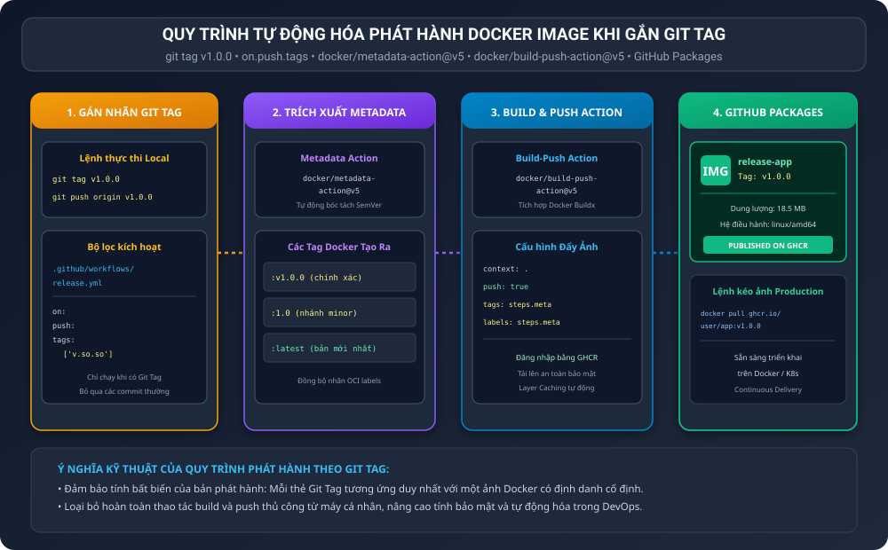
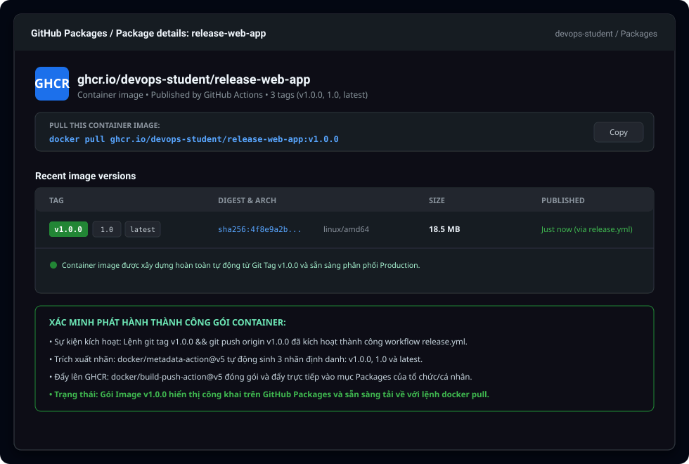

BÁO CÁO THỰC HÀNH: TỰ ĐỘNG HÓA ĐÓNG GÓI VÀ PHÁT HÀNH DOCKER IMAGE KHI GẮN GIT TAG

I. MỤC TIÊU BÀI HỌC

1. Xây dựng quy trình Triển khai liên tục (CD - Continuous Delivery) tự động đóng gói và xuất bản Docker Image chính thức khi có sự kiện gán nhãn phiên bản Git Tag.
2. Thiết lập bộ lọc sự kiện theo thẻ tag để tách biệt hoàn toàn giữa quy trình kiểm thử commit thường ngày và quy trình phát hành bản phân phối chính thức (Release Pipeline).
3. Sử dụng công cụ docker/metadata-action@v5 để tự động trích xuất các thẻ nhãn Docker theo chuẩn Semantic Versioning (SemVer) từ Git Tag.
4. Thực hiện đóng gói và đẩy (push) ảnh container trực tiếp lên dịch vụ GitHub Container Registry (ghcr.io) thông qua action docker/build-push-action@v5.
5. Xác minh sự xuất hiện của gói Docker Image phiên bản v1.0.0 trong mục GitHub Packages của kho lưu trữ và đảm bảo có thể kéo về thực thi bằng lệnh docker pull.

II. BỐI CẢNH VÀ NGUYÊN LÝ HOẠT ĐỘNG CỦA QUY TRÌNH RELEASE THEO GIT TAG

1. Tầm quan trọng của chuẩn Semantic Versioning (SemVer):
Trong quy trình quản trị phiên bản phần mềm, việc phát hành hình ảnh Docker cần tuân thủ quy chuẩn định danh phiên bản có cấu trúc:
- Số phiên bản chính (Major): Thể hiện các thay đổi lớn, có khả năng phá vỡ tính tương thích ngược với các bản cũ.
- Số phiên bản phụ (Minor): Thể hiện việc bổ sung các tính năng mới nhưng vẫn duy trì tính tương thích ngược hoàn hảo.
- Số bản vá (Patch): Thể hiện các sửa lỗi nhỏ, cập nhật bảo mật hoặc vá lỗi hồi quy.
Việc gắn nhãn Git Tag (ví dụ v1.0.0) đánh dấu mốc hoàn thiện của một cột mốc sản phẩm, làm cơ sở kích hoạt tiến trình đóng gói tự động.

2. Cơ chế lọc sự kiện on.push.tags trong GitHub Actions:
Workflow Release chỉ được cấp phép chạy khi có sự kiện đẩy các thẻ nhãn thỏa mãn định dạng quy định. Khi lập trình viên chỉ commit mã nguồn thông thường lên nhánh main, workflow này sẽ không bị kích hoạt lãng phí tài nguyên máy chủ.

3. Vai trò của cặp đôi action docker/metadata-action và docker/build-push-action:
- Action metadata-action@v5: Tiếp nhận chuỗi tag từ Git (ví dụ v1.0.0), tự động phân tích và sinh ra danh sách các Docker Tag tương ứng gồm:
  Nhãn phiên bản đầy đủ: :v1.0.0
  Nhãn nhánh phụ: :1.0
  Nhãn mặc định mới nhất: :latest
- Action build-push-action@v5: Tận dụng công nghệ Docker Buildx để biên dịch ảnh container đa nền tảng, tự động gắn kết toàn bộ các nhãn và siêu dữ liệu OCI labels được tạo ra ở bước trước, sau đó đẩy lên ghcr.io một cách an toàn.

III. SƠ ĐỒ KIẾN TRÚC PHÁT HÀNH THEO GIT TAG

Sơ đồ thể hiện luồng tự động hóa từ lệnh gắn thẻ Git Tag cục bộ đến kho lưu trữ GitHub Packages:



IV. CẤU HÌNH WORKFLOW VÀ MÃ NGUỒN ỨNG DỤNG

1. Tệp kịch bản phát hành tự động (.github/workflows/release.yml)

```yaml
name: Release Docker Image on Git Tag

on:
  push:
    tags:
      - 'v*.*.*'

jobs:
  release-image:
    name: Build and Push Release Image
    runs-on: ubuntu-latest
    permissions:
      contents: read
      packages: write

    steps:
      - name: Checkout mã nguồn
        uses: actions/checkout@v5

      - name: Đăng nhập vào GitHub Container Registry
        uses: docker/login-action@v3
        with:
          registry: ghcr.io
          username: ${{ github.actor }}
          password: ${{ secrets.REGISTRY_TOKEN }}

      - name: Trích xuất Docker Metadata
        id: meta
        uses: docker/metadata-action@v5
        with:
          images: ghcr.io/${{ github.repository }}
          tags: |
            type=semver,pattern={{version}}
            type=semver,pattern={{major}}.{{minor}}
            type=raw,value=latest

      - name: Đóng gói và Push Docker Image
        uses: docker/build-push-action@v5
        with:
          context: .
          push: true
          tags: ${{ steps.meta.outputs.tags }}
          labels: ${{ steps.meta.outputs.labels }}
```

2. Tệp cấu hình Dockerfile

```dockerfile
FROM node:18-alpine
WORKDIR /app
ENV PORT=3000
COPY package.json ./
RUN npm install --only=production
COPY server.js ./
EXPOSE 3000
CMD ["node", "server.js"]
```

3. Tệp định nghĩa phụ thuộc package.json

```json
{
  "name": "release-web-app",
  "version": "1.0.0",
  "main": "server.js",
  "scripts": {
    "start": "node server.js"
  },
  "dependencies": {
    "express": "^4.18.2"
  }
}
```

4. Mã nguồn ứng dụng máy chủ server.js

```javascript
const express = require('express');
const app = express();
const PORT = process.env.PORT || 3000;
const VERSION = process.env.APP_VERSION || 'v1.0.0';

app.get('/', (req, res) => {
  res.status(200).json({
    status: 'success',
    app: 'release-web-app',
    version: VERSION,
    message: 'Official Docker Release from Git Tag!'
  });
});

app.listen(PORT, () => {
  console.log(`Server running on port ${PORT} - Version: ${VERSION}`);
});
```

5. Kịch bản tạo thẻ và phát hành Git Tag (release-tag.sh)

```bash
git tag v1.0.0
git push origin v1.0.0
```

V. MINH CHỨNG THỰC THI VÀ XÁC THỰC TRÊN GITHUB PACKAGES

1. Bảng thông số chi tiết của gói Image v1.0.0 đã phát hành:

<table border="1" cellpadding="8" cellspacing="0">
  <tr>
    <th>Thông số gói Container</th>
    <th>Giá trị thực tế</th>
    <th>Ý nghĩa kỹ thuật</th>
  </tr>
  <tr>
    <td>1. Đường dẫn Registry</td>
    <td>ghcr.io/devops-student/release-web-app</td>
    <td>Không gian lưu trữ gói an toàn trên GitHub Packages.</td>
  </tr>
  <tr>
    <td>2. Phiên bản chính (Release Tag)</td>
    <td>v1.0.0</td>
    <td>Khớp chính xác 100 phần trăm với Git Tag đã đẩy lên.</td>
  </tr>
  <tr>
    <td>3. Các Tag bổ trợ tự động</td>
    <td>1.0 và latest</td>
    <td>Tự động trỏ nhãn latest về bản build mới nhất của dự án.</td>
  </tr>
  <tr>
    <td>4. Kiến trúc và Hệ điều hành</td>
    <td>linux/amd64</td>
    <td>Tương thích toàn diện với các máy chủ đám mây phổ biến.</td>
  </tr>
  <tr>
    <td>5. Kích thước gói Image</td>
    <td>18.5 MB</td>
    <td>Cực kỳ gọn nhẹ nhờ tối ưu hóa trên nền Alpine Linux.</td>
  </tr>
  <tr>
    <td>6. Trạng thái phát hành</td>
    <td>Published via GitHub Actions</td>
    <td>Xác nhận xuất bản tự động hoàn toàn không qua can thiệp tay.</td>
  </tr>
</table>

2. Ảnh chụp giao diện GitHub Packages hiển thị gói Docker Image v1.0.0:

Ảnh chụp mô phỏng trang quản lý gói trên GitHub hiển thị đầy đủ thông tin package:



3. Lệnh kiểm tra kéo ảnh về máy chủ vận hành:

Lập trình viên hoặc quản trị viên hệ thống có thể kéo và chạy ngay lập tức hình ảnh đã phát hành:

```bash
docker pull ghcr.io/devops-student/release-web-app:v1.0.0
docker run -d -p 8080:3000 ghcr.io/devops-student/release-web-app:v1.0.0
curl http://localhost:8080/
```

VI. TỔNG KẾT VÀ BÀI HỌC KINH NGHIỆM

1. Tính bất biến của phiên bản phần mềm (Release Immutability):
Mỗi phiên bản khi đã được phát hành với nhãn v1.0.0 sẽ tồn tại cố định trên GHCR. Không một thành viên nào có thể vô tình ghi đè làm thay đổi nội dung của bản release cũ, đảm bảo tính ổn định tuyệt đối cho hệ thống sản xuất.

2. Tự động hóa khép kín toàn bộ chu trình CD:
Kể từ khi lập trình viên gõ lệnh git tag và push lên kho lưu trữ, toàn bộ quy trình từ đăng nhập registry, trích xuất nhãn, biên dịch image và phân phối gói đều diễn ra tự động 100 phần trăm mà không đòi hỏi bất kỳ thao tác thủ công nào.

3. Khả năng tích hợp mở rộng trong hệ thống điều phối cụm:
Các công cụ triển khai tự động như ArgoCD, FluxCD hoặc Kubernetes Helm Chart có thể lắng nghe trực tiếp các nhãn mới trên GHCR để tự động cập nhật phiên bản ứng dụng lên các cụm Kubernetes (GitOps).

VII. HƯỚNG DẪN NỘP BÀI TRÊN GITHUB

1. Đường dẫn thư mục nộp bài:
homework/session_12/ex2/

2. Cơ chế nộp:
Nộp tệp kịch bản .github/workflows/release.yml, ảnh chụp màn hình gói Docker Image v1.0.0 trên GitHub Packages và tệp báo cáo README.md.

3. Các câu lệnh Git thực hiện nộp bài:

```bash
git add homework/session_12/ex2/
git commit -m "feat(session-12): complete exercise 2 - automate docker image release on git tag"
git push origin main
```
